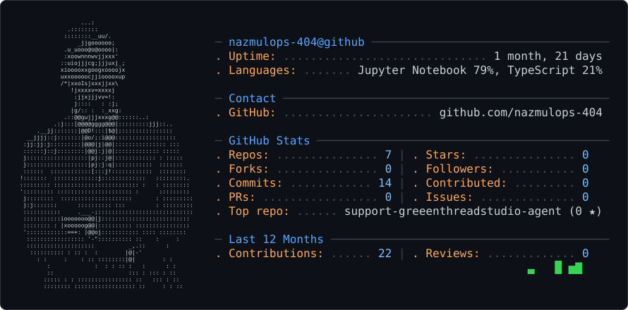

<picture>
  <source media="(prefers-color-scheme: dark)" srcset="dark_mode.svg" />
  <source media="(prefers-color-scheme: light)" srcset="light_mode.svg" />
  
</picture>
<svg xmlns="http://www.w3.org/2000/svg" width="890" height="440" viewBox="0 0 890 440" role="img" aria-label="ASCII GitHub profile card for nazmulops-404">
  <rect x="0.5" y="0.5" width="889" height="439" rx="8" fill="#0d1117" stroke="#30363d"/>
  <text x="28" y="34.6" fill="#c9d1d9" font-family="'Consolas', 'Menlo', 'DejaVu Sans Mono', monospace" xml:space="preserve" font-size="8">                  ...:</text>
  <text x="28" y="44.2" fill="#c9d1d9" font-family="'Consolas', 'Menlo', 'DejaVu Sans Mono', monospace" xml:space="preserve" font-size="8">              .::::::::</text>
  <text x="28" y="53.8" fill="#c9d1d9" font-family="'Consolas', 'Menlo', 'DejaVu Sans Mono', monospace" xml:space="preserve" font-size="8">             ::::::::__uu/.</text>
  <text x="28" y="63.400000000000006" fill="#c9d1d9" font-family="'Consolas', 'Menlo', 'DejaVu Sans Mono', monospace" xml:space="preserve" font-size="8">                 _jjgoooooo;</text>
  <text x="28" y="73" fill="#c9d1d9" font-family="'Consolas', 'Menlo', 'DejaVu Sans Mono', monospace" xml:space="preserve" font-size="8">             .u_uooo@o@oooo|:</text>
  <text x="28" y="82.6" fill="#c9d1d9" font-family="'Consolas', 'Menlo', 'DejaVu Sans Mono', monospace" xml:space="preserve" font-size="8">             :xoownnnwvjjxxx'</text>
  <text x="28" y="92.2" fill="#c9d1d9" font-family="'Consolas', 'Menlo', 'DejaVu Sans Mono', monospace" xml:space="preserve" font-size="8">            ::uiojjjcg;jjjuxj_;</text>
  <text x="28" y="101.8" fill="#c9d1d9" font-family="'Consolas', 'Menlo', 'DejaVu Sans Mono', monospace" xml:space="preserve" font-size="8">            xiooooxxgoogxoooojx</text>
  <text x="28" y="111.39999999999999" fill="#c9d1d9" font-family="'Consolas', 'Menlo', 'DejaVu Sans Mono', monospace" xml:space="preserve" font-size="8">            uxxooooocjjiooooxup</text>
  <text x="28" y="121" fill="#c9d1d9" font-family="'Consolas', 'Menlo', 'DejaVu Sans Mono', monospace" xml:space="preserve" font-size="8">            /*|xxoIsjxxxjjxx\</text>
  <text x="28" y="130.6" fill="#c9d1d9" font-family="'Consolas', 'Menlo', 'DejaVu Sans Mono', monospace" xml:space="preserve" font-size="8">               !jxxxxv=xxxxj</text>
  <text x="28" y="140.2" fill="#c9d1d9" font-family="'Consolas', 'Menlo', 'DejaVu Sans Mono', monospace" xml:space="preserve" font-size="8">                :jjxjjjvv=!:</text>
  <text x="28" y="149.8" fill="#c9d1d9" font-family="'Consolas', 'Menlo', 'DejaVu Sans Mono', monospace" xml:space="preserve" font-size="8">                j::::   : :j;</text>
  <text x="28" y="159.4" fill="#c9d1d9" font-family="'Consolas', 'Menlo', 'DejaVu Sans Mono', monospace" xml:space="preserve" font-size="8">               |g/:: :  :_xxg:</text>
  <text x="28" y="169" fill="#c9d1d9" font-family="'Consolas', 'Menlo', 'DejaVu Sans Mono', monospace" xml:space="preserve" font-size="8">             .::@@gujjjxxxg@@::::::..:</text>
  <text x="28" y="178.6" fill="#c9d1d9" font-family="'Consolas', 'Menlo', 'DejaVu Sans Mono', monospace" xml:space="preserve" font-size="8">          .:j:::[@@@@gggg@@@|:::::::::jjj::..</text>
  <text x="28" y="188.2" fill="#c9d1d9" font-family="'Consolas', 'Menlo', 'DejaVu Sans Mono', monospace" xml:space="preserve" font-size="8">     .__jj:::::::|@@D!:::|$@|::::::::::::::::</text>
  <text x="28" y="197.79999999999998" fill="#c9d1d9" font-family="'Consolas', 'Menlo', 'DejaVu Sans Mono', monospace" xml:space="preserve" font-size="8">  __jjjj::j:::::::|@o/;:i@@@::::::::::::::::::</text>
  <text x="28" y="207.4" fill="#c9d1d9" font-family="'Consolas', 'Menlo', 'DejaVu Sans Mono', monospace" xml:space="preserve" font-size="8"> :jj:jj:j:::::::::|@@@|j|@@|::::::::::::::: :::</text>
  <text x="28" y="217" fill="#c9d1d9" font-family="'Consolas', 'Menlo', 'DejaVu Sans Mono', monospace" xml:space="preserve" font-size="8"> ::::::j::j::::::::|@@j:j|@|::::::::::::: :::::</text>
  <text x="28" y="226.6" fill="#c9d1d9" font-family="'Consolas', 'Menlo', 'DejaVu Sans Mono', monospace" xml:space="preserve" font-size="8"> j::::::::::::::::::|pj::j@|:::::::::::: : :::::</text>
  <text x="28" y="236.2" fill="#c9d1d9" font-family="'Consolas', 'Menlo', 'DejaVu Sans Mono', monospace" xml:space="preserve" font-size="8"> j::::::::::::::::::|pj:j:q|:::::::::::  :::::::</text>
  <text x="28" y="245.79999999999998" fill="#c9d1d9" font-family="'Consolas', 'Menlo', 'DejaVu Sans Mono', monospace" xml:space="preserve" font-size="8"> ::::::  ::::::::::::[:::j!::::::::::::  ::::::::</text>
  <text x="28" y="255.39999999999998" fill="#c9d1d9" font-family="'Consolas', 'Menlo', 'DejaVu Sans Mono', monospace" xml:space="preserve" font-size="8">!:::::::  :::::::::::::j:::::::::::::   :::::::::.</text>
  <text x="28" y="265" fill="#c9d1d9" font-family="'Consolas', 'Menlo', 'DejaVu Sans Mono', monospace" xml:space="preserve" font-size="8">::::::::: ::::::::::::::::::::::::: :   : ::::::::</text>
  <text x="28" y="274.6" fill="#c9d1d9" font-family="'Consolas', 'Menlo', 'DejaVu Sans Mono', monospace" xml:space="preserve" font-size="8">'::::::::: :::::::::::::::::::::: :      :::::::::</text>
  <text x="28" y="284.2" fill="#c9d1d9" font-family="'Consolas', 'Menlo', 'DejaVu Sans Mono', monospace" xml:space="preserve" font-size="8"> j::::::::  :::::::::::::::::::::       : :::::::::</text>
  <text x="28" y="293.8" fill="#c9d1d9" font-family="'Consolas', 'Menlo', 'DejaVu Sans Mono', monospace" xml:space="preserve" font-size="8"> j:j:::::::      :::::::::: :::         : :::::::::</text>
  <text x="28" y="303.4" fill="#c9d1d9" font-family="'Consolas', 'Menlo', 'DejaVu Sans Mono', monospace" xml:space="preserve" font-size="8"> :::::::::::     .___-;::::::::::::::::::::::::::::</text>
  <text x="28" y="313" fill="#c9d1d9" font-family="'Consolas', 'Menlo', 'DejaVu Sans Mono', monospace" xml:space="preserve" font-size="8"> :::::::::::iooooooo@@|j::::::::::::::::::::::::::</text>
  <text x="28" y="322.59999999999997" fill="#c9d1d9" font-family="'Consolas', 'Menlo', 'DejaVu Sans Mono', monospace" xml:space="preserve" font-size="8"> :::::::: : |xooooog@@|:::::::::: ::::::::::::::::</text>
  <text x="28" y="332.2" fill="#c9d1d9" font-family="'Consolas', 'Menlo', 'DejaVu Sans Mono', monospace" xml:space="preserve" font-size="8"> '::::::::::::==+: |@@oj::::::::::: :::: ::::::::</text>
  <text x="28" y="341.8" fill="#c9d1d9" font-family="'Consolas', 'Menlo', 'DejaVu Sans Mono', monospace" xml:space="preserve" font-size="8">  ::::::::::::::::: '-&quot;:::::::::: ::    :     :</text>
  <text x="28" y="351.4" fill="#c9d1d9" font-family="'Consolas', 'Menlo', 'DejaVu Sans Mono', monospace" xml:space="preserve" font-size="8">  ::::::::::::::::::::          _,.::      :</text>
  <text x="28" y="361" fill="#c9d1d9" font-family="'Consolas', 'Menlo', 'DejaVu Sans Mono', monospace" xml:space="preserve" font-size="8">   :::::::::: : :: :  :        |@|-'</text>
  <text x="28" y="370.59999999999997" fill="#c9d1d9" font-family="'Consolas', 'Menlo', 'DejaVu Sans Mono', monospace" xml:space="preserve" font-size="8">     : :     :    : :: ::::::::|@|        : :</text>
  <text x="28" y="380.2" fill="#c9d1d9" font-family="'Consolas', 'Menlo', 'DejaVu Sans Mono', monospace" xml:space="preserve" font-size="8">        :             :  : : :: :   :      : :</text>
  <text x="28" y="389.8" fill="#c9d1d9" font-family="'Consolas', 'Menlo', 'DejaVu Sans Mono', monospace" xml:space="preserve" font-size="8">        ::                      ::: : ::: : ::</text>
  <text x="28" y="399.4" fill="#c9d1d9" font-family="'Consolas', 'Menlo', 'DejaVu Sans Mono', monospace" xml:space="preserve" font-size="8">       ::::: : : :::::::::::::::: ::   ::: : ::</text>
  <text x="28" y="409" fill="#c9d1d9" font-family="'Consolas', 'Menlo', 'DejaVu Sans Mono', monospace" xml:space="preserve" font-size="8">       :::::::: :::::::::::::::::: ::     : : ::</text>
  <text x="304.79999999999995" y="65" font-family="'Consolas', 'Menlo', 'DejaVu Sans Mono', monospace" xml:space="preserve" font-size="16"><tspan fill="#3d444d">─</tspan><tspan fill="#58a6ff"> nazmulops-404@github </tspan><tspan fill="#3d444d">───────────────────────────────────</tspan></text>
  <text x="304.79999999999995" y="85" font-family="'Consolas', 'Menlo', 'DejaVu Sans Mono', monospace" xml:space="preserve" font-size="16"><tspan fill="#ffa657">. Uptime: </tspan><tspan fill="#484f58">..............................</tspan><tspan fill="#c9d1d9"> 1 month, 21 days</tspan></text>
  <text x="304.79999999999995" y="105" font-family="'Consolas', 'Menlo', 'DejaVu Sans Mono', monospace" xml:space="preserve" font-size="16"><tspan fill="#ffa657">. Languages: </tspan><tspan fill="#484f58">.......</tspan><tspan fill="#c9d1d9"> Jupyter Notebook 79%, TypeScript 21%</tspan></text>
  <text x="304.79999999999995" y="145" font-family="'Consolas', 'Menlo', 'DejaVu Sans Mono', monospace" xml:space="preserve" font-size="16"><tspan fill="#3d444d">─</tspan><tspan fill="#58a6ff"> Contact </tspan><tspan fill="#3d444d">────────────────────────────────────────────────</tspan></text>
  <text x="304.79999999999995" y="165" font-family="'Consolas', 'Menlo', 'DejaVu Sans Mono', monospace" xml:space="preserve" font-size="16"><tspan fill="#ffa657">. GitHub: </tspan><tspan fill="#484f58">......................</tspan><tspan fill="#c9d1d9"> github.com/nazmulops-404</tspan></text>
  <text x="304.79999999999995" y="205" font-family="'Consolas', 'Menlo', 'DejaVu Sans Mono', monospace" xml:space="preserve" font-size="16"><tspan fill="#3d444d">─</tspan><tspan fill="#58a6ff"> GitHub Stats </tspan><tspan fill="#3d444d">───────────────────────────────────────────</tspan></text>
  <text x="304.79999999999995" y="225" font-family="'Consolas', 'Menlo', 'DejaVu Sans Mono', monospace" xml:space="preserve" font-size="16"><tspan fill="#ffa657">. Repos: </tspan><tspan fill="#484f58">...............</tspan><tspan fill="#79c0ff"> 7</tspan><tspan fill="#3d444d"> | </tspan><tspan fill="#ffa657">. Stars: </tspan><tspan fill="#484f58">...............</tspan><tspan fill="#79c0ff"> 0</tspan></text>
  <text x="304.79999999999995" y="245" font-family="'Consolas', 'Menlo', 'DejaVu Sans Mono', monospace" xml:space="preserve" font-size="16"><tspan fill="#ffa657">. Forks: </tspan><tspan fill="#484f58">...............</tspan><tspan fill="#79c0ff"> 0</tspan><tspan fill="#3d444d"> | </tspan><tspan fill="#ffa657">. Followers: </tspan><tspan fill="#484f58">...........</tspan><tspan fill="#79c0ff"> 0</tspan></text>
  <text x="304.79999999999995" y="265" font-family="'Consolas', 'Menlo', 'DejaVu Sans Mono', monospace" xml:space="preserve" font-size="16"><tspan fill="#ffa657">. Commits: </tspan><tspan fill="#484f58">............</tspan><tspan fill="#79c0ff"> 14</tspan><tspan fill="#3d444d"> | </tspan><tspan fill="#ffa657">. Contributed: </tspan><tspan fill="#484f58">.........</tspan><tspan fill="#79c0ff"> 0</tspan></text>
  <text x="304.79999999999995" y="285" font-family="'Consolas', 'Menlo', 'DejaVu Sans Mono', monospace" xml:space="preserve" font-size="16"><tspan fill="#ffa657">. PRs: </tspan><tspan fill="#484f58">.................</tspan><tspan fill="#79c0ff"> 0</tspan><tspan fill="#3d444d"> | </tspan><tspan fill="#ffa657">. Issues: </tspan><tspan fill="#484f58">..............</tspan><tspan fill="#79c0ff"> 0</tspan></text>
  <text x="304.79999999999995" y="305" font-family="'Consolas', 'Menlo', 'DejaVu Sans Mono', monospace" xml:space="preserve" font-size="16"><tspan fill="#ffa657">. Top repo: </tspan><tspan fill="#484f58">......</tspan><tspan fill="#c9d1d9"> support-greeenthreadstudio-agent (0 ★)</tspan></text>
  <text x="304.79999999999995" y="345" font-family="'Consolas', 'Menlo', 'DejaVu Sans Mono', monospace" xml:space="preserve" font-size="16"><tspan fill="#3d444d">─</tspan><tspan fill="#58a6ff"> Last 12 Months </tspan><tspan fill="#3d444d">─────────────────────────────────────────</tspan></text>
  <text x="304.79999999999995" y="365" font-family="'Consolas', 'Menlo', 'DejaVu Sans Mono', monospace" xml:space="preserve" font-size="16"><tspan fill="#ffa657">. Contributions: </tspan><tspan fill="#484f58">......</tspan><tspan fill="#79c0ff"> 22</tspan><tspan fill="#3d444d"> | </tspan><tspan fill="#ffa657">. Reviews: </tspan><tspan fill="#484f58">.............</tspan><tspan fill="#79c0ff"> 0</tspan></text>
  <text x="304.79999999999995" y="385" font-family="'Consolas', 'Menlo', 'DejaVu Sans Mono', monospace" xml:space="preserve" font-size="16"><tspan fill="#39d353">                                              ▃   █ ▅▇</tspan></text>
</svg>
